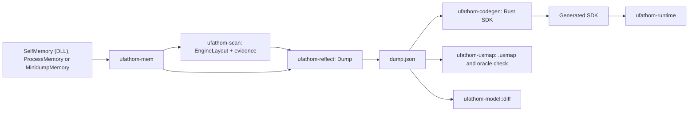

# Architecture

ufathom is a DLL that runs inside an Unreal Engine game and writes a versioned JSON dump, a usmap and a Rust SDK. It aims to do that job better than Dumper-7's DLL. The same pipeline also runs from outside the game, against a process or a minidump. This document is the contract between crates. Code that disagrees with it is a bug in one of the two; change them together.

## Modes

| Mode | Reader | Status | Use |
|---|---|---|---|
| **DLL** (primary) | `SelfMemory` | First-class | Normal use: load `ufathom.dll` in the game |
| External | `ProcessMemory` | Secondary | No code in the target. Same results when reads are allowed |
| Offline | `MinidumpMemory` | Secondary | Analysis and reproduction without the game |

The modes differ only in the `MemoryReader` they pass in. Discovery, reflection and generators do not know which one runs.

## Principles

1. **The dump never endangers the game.** The dump path never dereferences a raw target pointer, calls a game function, installs a hook or writes to game memory, even inside the DLL. All reads go through `MemoryReader`, so a wrong offset is an error, not an access violation.
2. **The dump never blocks the game.** It runs on background threads at reduced priority with bounded memory. It does not need the game thread.
3. **Target memory is untrusted input.** Every count, pointer and string may be wrong, or may change while being read. Parsers bound every loop, detect cycles and return errors. Target data never causes a panic.
4. **Solve, do not assume.** Offsets are derived from invariants the engine must satisfy. A version number or a profile is a hint that orders candidates. It never overrides evidence.
5. **Refuse rather than guess.** If an essential offset has no evidence, discovery fails and names what is missing. No silent default offsets.
6. **Claims need proof.** A version is listed as supported in `COMPATIBILITY.md` only with a recorded verification.

## Better than Dumper-7's DLL: acceptance criteria

These are testable, and each needs a real result before it is claimed.

| # | Criterion | Why it matters |
|---|---|---|
| 1 | A wrong layout or corrupted object leaves the game running and produces a named error | Crashes are the most common Dumper-7 report |
| 2 | The game keeps running normally during a dump, measured on the fake host and on real games | The patched fork used for DBD blocked the game thread for seconds |
| 3 | All four target builds dump with no manual offsets | Layout tables and manual overrides are the main maintenance cost |
| 4 | `GWorld` and the name table address are found on 3.7.2 | Dumper-7's output there records both as 0 |
| 5 | Dump again without reloading, then unload cleanly with no threads left | Reloading risked a broken state |
| 6 | Each dump gets its own folder and `identity.json` | Results must be traceable to a build |
| 7 | Works from long install paths | A real failure on a long Steam path |
| 8 | The output SDK compiles, always | Compile failures are a recurring Dumper-7 issue |

## Workspace

| Crate | Purpose | Depends on |
|---|---|---|
| `ufathom-mem` | `MemoryReader`, snapshots, page cache, self, process and minidump backends | none |
| `ufathom-model` | `EngineLayout`, dump IR, structural diff. Plain data | none |
| `ufathom-engine` | Typed views over remote memory: names, objects, properties | mem, model |
| `ufathom-scan` | PE parsing, version detection, discovery, layout solver, evidence | mem, model, engine |
| `ufathom-reflect` | Walks objects, builds a `Dump`, reports diagnostics | mem, model, engine |
| `ufathom-usmap` | `.usmap` reader and writer, comparison against a dump | model |
| `ufathom-codegen` | Rust SDK generator | model |
| `ufathom-runtime` | Library used by generated SDKs | mem, model, engine |
| `ufathom-testkit` | Synthetic UE images, corruption injection, fake target process | mem, model |
| `ufathom-agent` | Dump session logic behind the DLL: config, commands, output folders, identity. No FFI | mem, model, scan, reflect, usmap, codegen |
| `ufathom-dll` | The `ufathom.dll` cdylib: `DllMain`, thread lifecycle, hotkeys, panic containment | agent |
| `ufathom-cli` | The `ufathom` binary. The only crate using `anyhow` and `clap` | all except testkit and dll |

`ufathom-testkit` is a dev-dependency only. `ufathom-codegen` and `ufathom-usmap` must not depend on memory access. Do not add a crate without a reason recorded here.



## Calibration data from the target builds

Facts from the executables and from Dumper-7 output for the same builds. Fixtures must reproduce them. The solver must discover them, never read them from a table. Empty cells are unknown and must be found by the solver.

| | DBD 2.6.4 | DBD 3.7.2 | DBD 4.4.2 | DBD 8.1.0 |
|---|---|---|---|---|
| Engine | 4.21.1 | 4.22.3 | 4.25.1 | UE5, minor unverified |
| Changelist | 94430 | 299508 | 377698 | |
| `FName` | 8: cmp, number | **12**: cmp, display, number | **12**: cmp, display, number | |
| `UObject` index, class, name, outer | 0xC, 0x10, 0x18, 0x20 | 0xC, 0x10, 0x18, 0x28 | 0xC, 0x10, 0x18, 0x28 | |
| `sizeof(UObject)` | 0x28 | 0x30 | 0x30 | |
| `UField::Next` | 0x28 | 0x30 | 0x30 | |
| `UStruct` super, children | 0x30, 0x38 | 0x48, 0x50 | 0x48, 0x50 | |
| `UStruct` child properties | none | none | 0x58 | |
| `UStruct` size, alignment | 0x40, 0x44 | 0x58, 0x5C | | |
| `UFunction` flags, native func | 0x88, 0xB0 | 0xA0, 0xC8 | | |
| `UEnum::Names` | 0x40 | 0x48 | | |
| `UClass` cast flags, CDO | | 0xC0, 0x108 | | |
| Property system | `UProperty` | `UProperty` | `FField` / `FProperty` | `FField` / `FProperty` |
| Array dim, element size, flags, offset | 0x30, 0x34, 0x38, 0x44 | 0x38, 0x3C, 0x40, 0x4C | element 0x3C, offset 0x4C | |
| `sizeof(UProperty)` | 0x70 | 0x80 | | |
| `FField` next, name | | | 0x20, 0x28 | |
| Name table | not `FNamePool` | not `FNamePool` | `FNamePool` | `FNamePool` expected |
| Pool blocks, stride | | | +0x10, 4 | |
| Pool entry header, chars, length | | | +4, +6, `header >> 1` | |
| Object array | chunked, 0x10000 per chunk | chunked | chunked | |
| `FUObjectItem` size | | 0x18 | | |
| ProcessEvent vtable index | 0x40 | 0x40 | | |

Typed property payloads in 3.7.2 start at `sizeof(UProperty)` = 0x80: bool `{field_size, byte_offset, byte_mask, field_mask}`, struct, array inner, object class, map key then value at +8, enum underlying then enum at +8. `UClassProperty::MetaClass` sits 8 past the object class.

## `ufathom-mem`

```rust
pub type Addr = u64;

pub trait MemoryReader: Send + Sync {
    fn read_exact(&self, addr: Addr, buf: &mut [u8]) -> Result<(), MemError>;
    fn regions(&self) -> Result<Vec<MemoryRegion>, MemError>;
    fn modules(&self) -> Result<Vec<ModuleInfo>, MemError>;
}
```

- There is no write method anywhere in this crate.
- `read_exact` must never fault, whatever the address. This is what makes the DLL safe.
- `MemoryReaderExt` adds `read_pod::<T: Pod>`, `read_u32`, `read_u64`, `read_vec`, `read_cstr(addr, max)`.
- `Pod` is an `unsafe trait` for types valid for every bit pattern. Never `bool`, never Rust enums, never references.
- `MemoryRegion { base, size, perms: Perms, kind: RegionKind }`, `ModuleInfo { name, path, base, size }`.
- Backends:
  - `Snapshot`: in-memory regions with holes, used by tests.
  - `PageCache<M>`: 4 KiB read-through cache, thread-safe, caches failed pages, exposes hit and miss counters.
  - `MinidumpMemory`: parses a full-memory `.dmp` through `memmap2`, using `MemoryListStream`, `Memory64ListStream`, `ModuleListStream`, `MemoryInfoListStream`.
  - `SelfMemory`: the DLL's reader. Uses `ReadProcessMemory(GetCurrentProcess(), ...)`, which returns an error on unreadable or guarded pages instead of faulting. Regions and modules come from `VirtualQuery` and the module list. **Never** reads through a raw pointer, even after `VirtualQuery`, since pages can be unmapped between the check and the read.
  - `ProcessMemory`: Windows through `windows-sys`, Linux through `process_vm_readv` and `/proc`. `cfg`-gated, same API. Opens the handle with `PROCESS_QUERY_INFORMATION | PROCESS_VM_READ` only.
- `list_processes() -> Vec<ProcessInfo>` enumerates targets. Access errors are reported, never bypassed.

## `ufathom-model`

Plain `serde` data, no I/O.

`EngineLayout` holds everything needed to read this build:

```rust
pub struct EngineLayout {
    pub pointer_size: u8,
    pub names: NameTableLayout,
    pub objects: ObjectArrayLayout,
    pub fname: FNameLayout,      // size, comparison_index, display_index?, number?
    pub uobject: UObjectLayout,  // flags, index, class, name, outer, size
    pub ufield: UFieldLayout,    // next
    pub ustruct: UStructLayout,  // super_struct, children, child_properties?, properties_size, min_alignment, min_alignment_width
    pub uclass: UClassLayout,    // cast_flags?, default_object?
    pub ufunction: UFunctionLayout, // flags, native_func?
    pub uenum: UEnumLayout,      // PairArray { offset, stride, value_offset, value_width } or SplitArrays { .. }
    pub properties: PropertyLayout,
}

pub enum Location { Rva { module: String, rva: u64 }, Absolute(u64) }

pub enum NameTableLayout {
    Pool(NamePoolLayout),   // location, blocks, current_block, cursor, stride, block_offset_bits, entry
    Array(NameArrayLayout), // location, indirect, num_elements, num_chunks, elements_per_chunk, entry
}

pub struct ObjectArrayLayout {
    pub location: Location,
    pub kind: ObjectArrayKind,  // Fixed or Chunked { elements_per_chunk }
    pub objects: u32,
    pub max_elements: u32,
    pub num_elements: u32,
    pub max_chunks: Option<u32>,
    pub num_chunks: Option<u32>,
    pub item_size: u32,
    pub item_object: u32,
    pub item_serial: Option<u32>,
    pub pointer_transform: Vec<TransformOp>, // Xor, Add, Sub, RotateLeft, RotateRight, Not
}

pub enum PropertySystem { Legacy, Modern { ffield: FFieldLayout, field_class: FFieldClassLayout } }
```

`pointer_transform` matches the idea of Dumper-7's user-supplied object array decryption: the user states the transform in a config file, the tool never searches for or ships keys.

`Dump` is the versioned IR: `format_version`, `tool`, `target`, `engine`, `layout`, sorted `packages`, `structs` (classes and script structs), `enums`, and `diagnostics`.

- `StructDef { path, name, package, kind, super_path, size, alignment, fields, functions, flags }`
- `FieldDef { name, offset, ty, element_size, array_dim, flags }`
- `FunctionDef { name, path, flags, params_size, params, native_rva }`
- `EnumDef { path, name, package, underlying_size, values }`
- `PropertyType`: integers, floats, `Bool { byte_offset, byte_mask, field_mask, field_size }`, `Name`, `Str`, `Text`, `Object { class }`, `Class { class, meta }`, `WeakObject`, `LazyObject`, `SoftObject`, `SoftClass`, `Interface`, `Struct { path }`, `Array { inner }`, `Set { element }`, `Map { key, value }`, `Enum { path, underlying }`, `Byte { path }`, `Delegate`, `MulticastInlineDelegate`, `MulticastSparseDelegate`, `FieldPath`, `Optional { inner }`, `Unknown { type_name }`.

Output is deterministic: everything sorted by path, no timestamps. Two dumps of one build must be byte-identical unless the set of loaded objects differs.

`ufathom_model::diff` compares two dumps for porting work between game versions. Types match by package and name. It reports added and removed types, parent, size and field changes, enum value changes, and function ABI changes: parameters by order and layout, return, out, reference and const flags, network flags, and bool mask and byte offset. A renamed parameter is not an ABI change. A missing function is searched through ancestors. Duplicate names are reported as ambiguous, never resolved by picking one. Addresses and member order produce no noise.

## `ufathom-engine`

Views that combine a `&dyn MemoryReader` with an `EngineLayout`. Generation differences live behind one interface:

```rust
pub trait PropertySystemReader {
    fn fields(&self, owner: Addr) -> FieldIter<'_>;
    fn decode(&self, field: Addr) -> Result<RawProperty, EngineError>;
}
```

- `LegacyProperties`: `UStruct::Children` linked list, filtered by class, for `UProperty`.
- `ModernProperties`: `UStruct::ChildProperties` linked list of `FField`.
- `NameTable::load`: bulk-loads names in parallel. Pool mode walks blocks and records entry starts. Array mode walks chunks. `resolve(fname_bytes)` applies `Number` as `name_{N-1}`. Decoding tries UTF-8, then falls back to Latin-1. Wide entries are UTF-16 lossy. A name lookup never panics.
- `ObjectArrayView`: slot to pointer, applies `pointer_transform`.
- Limits as named constants: maximum chain length, maximum name length, maximum properties per struct. Exceeding one is a diagnostic.

## `ufathom-scan`

Entry point:

```rust
pub fn discover(mem: &dyn MemoryReader, options: &DiscoverOptions) -> Result<Discovery, ScanError>;

pub struct Discovery {
    pub layout: EngineLayout,
    pub engine: EngineInfo,
    pub globals: Globals, // gworld?, gengine?, process_event_index?, process_event_rva?
    pub evidence: Vec<Evidence>,
    pub warnings: Vec<String>,
}

pub struct Evidence { pub field: String, pub value: u64, pub method: String, pub samples: u32, pub matched: u32 }
```

`DiscoverOptions` carries the module name, hint profile and manual overrides from a layout file. An overridden value is still validated, and a contradiction is reported, not hidden.

Steps, all using `.data` and heap reads only. No signature is needed for the main path.

1. **Module.** Parse the PE from memory. Collect sections and image ranges. Read the writable sections once into local buffers and scan locally to avoid per-slot remote reads.
2. **Object array.** For each pointer-aligned slot holding a mapped pointer, look at a window around it for 32-bit fields in any order, satisfying `num <= max`, `num_chunks <= max_chunks`, `max % max_chunks == 0`, `num_chunks == ceil(num / per_chunk)`. Also accept the fixed form. Then infer `(item_size, item_object, uobject.index)` by requiring that the object in slot `i` stores `i`. Require a vtable inside the image. Dumper-7 keeps a growing list of per-game layouts. This step should make such a list unnecessary.
3. **Name table.**
   - Pool: in writable sections, find a run of block pointers preceded by two `u32` where `current_block + 1 == run length` and the first block starts with `None` then `ByteProperty`.
   - Array: a pointer chain to chunks whose entries 0 and 1 are `None` and `ByteProperty`.
   - Fallback: scan private regions for the `ByteProperty` bytes, then look for a pointer to that block.
   - Entry format is inferred. String offset comes from the position of `None`, stride from the distance to `ByteProperty`, length shift by requiring `None` = 4 and `ByteProperty` = 12. The 4.4.2 values (+4, +6, `>> 1`, stride 4) must come out of this without special cases.
   - `block_offset_bits` is confirmed by requiring object names to land on recorded entry starts.
4. **`FName` shape.** Decide between 4, 8, 12 and 16 bytes by decoding names at the solved offset and looking at how much of the next field is a plausible number or a duplicate index. 3.7.2 and 4.4.2 use 12 bytes.
5. **`UObject`.** Class is the offset whose chain reaches a fixed point named `Class`. Name decodes for at least 99% of samples. Outer chains terminate at null within a bounded depth with a `Package` at the top. Flags: `Default__*` objects have the 0x10 bit, others do not.
6. **`UStruct`, `UField`, `UClass`, `UFunction`, `UEnum`.** Anchored on CoreUObject, compared case-insensitively because some builds spell names differently.
   - `Struct.super == Field`, `Class.super == Struct`, `Field.super == Object`.
   - Size: `Guid` = 0x10, `Color` = 4. Alignment follows it.
   - Children: the pointer whose target's outer is the owner.
   - Child properties: the pointer whose target is not a UObject and whose chain yields `A, B, C, D` for `Guid`.
   - Function flags: the `u32` where `ReceiveBeginPlay` has `BlueprintEvent` without `Native` and `K2_DestroyActor` has `Native | BlueprintCallable`.
   - Enum names: the `TArray`-shaped field whose elements decode to the enum's own names.
7. **Properties.**
   - From `Guid` fields: offset is the field reading 0, 4, 8, 12, element size is the field reading 4, array dim sits next to it reading 1.
   - Flags: the `u64` where `ReturnValue` in a function has `Parm | ReturnParm` and class members do not.
   - Typed payloads: anchored on known fields, such as `Transform.Translation` to `Vector`.
   - `FFieldClass` name: scan offsets for a name reading `IntProperty`. UE 5.8 moved it. This must not be hard-coded.
8. **Globals.** `GWorld` and `GEngine`: a slot in writable sections pointing to a non-CDO instance of `World` or `GameEngine`. Report all candidates when ambiguous. `ProcessEvent`: scan vtable functions of object 0 for `test [reg+FunctionFlags], FUNC_Native` and `FUNC_HasOutParms` encodings.
9. **Version.** `VS_VERSIONINFO` `ProductVersion`, UTF-16 `++Project+Branch-CL-N` strings, and structural range facts (`FField` implies at least 4.25, `FNamePool` implies at least 4.23). `EngineInfo` reports a claimed version, a range and the evidence. Absence is not fatal.
10. **Validation.** Before returning, check global invariants: every sampled property fits inside its struct, super chains end at `Object`, derived size is at least base size. Failure is a `ScanError` naming the invariant.

Static mode (`inspect_exe`) loads a PE file into a `Snapshot` by section and runs only steps 1 and 9.

## `ufathom-reflect`

`build_dump(mem, discovery, options) -> Result<Dump, ReflectError>`.

The game keeps running during a dump, so objects can be freed or reused mid-read. Each parsed struct is re-validated at the end: the array slot must still point to the same address and the object must still store its index. A mismatch means one re-read, then a diagnostic. A `PageCache` lives for a single dump pass, never across dumps.

Parallel work uses a `rayon::ThreadPool` passed in through options, never the global pool, because global pool threads cannot be stopped and would block DLL unload.

1. Read all object headers in parallel, through `PageCache`.
2. Build address to path and class hierarchy maps. Classify by walking the class chain.
3. Parse structs, enums and functions in parallel. A failure in one object becomes a `Diagnostic` with its path. It never aborts the walk.
4. Unknown property classes become `PropertyType::Unknown` with the correct size.
5. If over 5% of objects fail, the dump is marked degraded and the CLI exits non-zero unless `--allow-degraded`.

## `ufathom-agent` and `ufathom-dll`

`ufathom-agent` holds all session logic and is plain Rust, so it can be tested without loading a DLL. `ufathom-dll` is a thin shell.

**DLL lifecycle:**

1. `DllMain` on attach: `DisableThreadLibraryCalls`, then `CreateThread`, nothing else. No allocation-heavy work, no locks, no `std::thread` under the loader lock.
2. Worker thread: take a named per-process mutex. A second instance logs the refusal and exits without touching anything. Load config, start the log, publish `status: ready`.
3. Serve triggers: delay, hotkey, command file. A dump runs on a `rayon::ThreadPool` of at most 4 threads at below-normal priority.
4. `stop`: refuse new commands, finish or cancel the running dump between objects, drop the pool and its threads, close files, publish `status: stopped`, then `FreeLibraryAndExitThread`.

**Containment.** Thread entry points run under `catch_unwind`, and a panic hook writes to the log file. The workspace must build with `panic = "unwind"`: `abort` would kill the game. The DLL links the CRT statically (`+crt-static`) so it does not depend on the game's installed runtime.

**Config.** `ufathom.toml` beside the game executable, then beside the DLL, then defaults. An invalid config is a logged error plus safe defaults. Keys: output path, formats, trigger delay, hotkeys, auto-dump, auto-unload, thread count. `auto_dump` defaults to off, so loading the DLL costs nothing until asked.

**Output.** `<output>/<build id>/<session>/<dump label>/` with `dump.json`, `Mappings.usmap`, `sdk/`, `identity.json` and `ufathom.log`. Nothing is overwritten. All paths are normalized and opened with the `\\?\` extended form on Windows.

`identity.json`: game path, SHA-256 of the game and DLL, PID, engine info, tool version, config used, discovered offsets, evidence and capture time. This file may contain time, since it describes a run. `dump.json` stays deterministic.

**Commands.** JSON files in `<output>/control/inbox/`, each with an ID. Results are published atomically to `outbox/`. Handled commands move to `archive/`. Commands: `status`, `dump` (with label and formats), `stop`.

**Hotkeys.** Polled only while a window of this process is in the foreground. Defaults: F8 dump, F6 unload.

**Loading.** The project ships the DLL, not an injector. Loading it is the user's choice: their own loader or a proxy DLL. No stealth, no anti-cheat bypass.

## `ufathom-codegen`

`generate(dump, options, out_dir)`. Output is one crate with one module per package, and Cargo features per package.

Why one crate: Rust modules may reference each other cyclically, so no package cycle elimination is needed. Cargo features may also be cyclic. By-value struct containment is acyclic by construction.

Layout rules:

- Every type is `#[repr(C, align(N))]` with explicit padding, and asserts size and each field offset with `core::mem::offset_of!` at compile time.
- A planning pass produces fields in offset order. Anything that cannot be represented exactly (overlap, misalignment, unknown type, base larger than the first field offset) degrades to `[u8; N]` plus a doc comment and a diagnostic. The generated SDK must always compile.
- Generated types must be `Pod`: enums are `#[repr(transparent)]` newtypes with associated consts, because reading an unknown discriminant into a Rust `enum` is undefined behaviour. Booleans and bitfields are accessor methods over raw storage.
- Pointers are `Ptr<T>`, a transparent `u64` newtype. References are never stored in generated types.
- Inheritance: base embedded as `base` with `Deref`, plus `unsafe impl IsA<Base>` for every ancestor.
- `FName` is an alias chosen from the dump's `FNameLayout`.
- Type names come from the display index when `FName` has one, so case-mangled comparison entries do not produce duplicate types.
- `FieldRef` consts on each type, for remote reads: `AActor::ROOT_COMPONENT`.
- Functions generate parameter structs and wrappers requiring `&impl Executor`.
- Package files are rewritten only when their content hash changed.
- Names: Rust keywords become `r#`, collisions get numeric suffixes, identifiers are sanitized deterministically.

## `ufathom-runtime`

- Containers as `Pod` views: `Ptr<T>`, `TArray<T>`, `FString`, `FName` variants, `TMap`, `TSet`, `FText` opaque, delegates opaque, soft and weak pointers.
- In-process use is the main case, for mods written in Rust: `Ptr<T>` to `&T` through an `unsafe` conversion with a stated contract, plus safe checked lookups.
- `Session<M: MemoryReader>`: name table and objects from an `EngineLayout`, for any reader. `find_class`, `find_object`, `objects_of::<T>()`. `ObjectRef<T>::read()` and `.get(T::FIELD)`.
- `Executor` is the only way to call a game function. External sessions do not implement it, so a remote call does not compile.
- `InProcessExecutor` (`inproc` feature): created through `unsafe fn attach` with the contract "on the game thread". Calls ProcessEvent through the discovered vtable index. Checks object validity by index and serial before each call.
- Generated wrappers do not free memory the engine allocated for return values. This is documented on the wrapper.

## `ufathom-usmap`

Reads usmap versions 0 to 4, uncompressed and zstd (pure Rust `ruzstd`). Writes uncompressed usmap from a `Dump`. `compare(dump, usmap)` reports missing types, missing fields and type mismatches. This is the oracle check against existing Dumper-7 output.

## CLI

```
ufathom ps                          List processes, flag probable UE targets
ufathom inspect-exe <file>          Static facts, no process involved
ufathom status <output dir>         Read a running DLL's status file
ufathom command <output dir> <cmd>  Send status, dump or stop to a running DLL
ufathom probe <target>              Discovery with evidence
ufathom doctor <target>             Probe plus invariant report
ufathom dump <target> -o dump.json
ufathom gen <dump.json> -o sdk/
ufathom usmap <dump.json> -o out.usmap
ufathom check-oracle <dump.json> <file.usmap>
ufathom diff <old.json> <new.json> [--json]
```

`<target>` is `--pid N`, `--process NAME` or `--minidump PATH`, for external and offline use. Also `--module NAME` and `--layout FILE`.

## Testing

| Level | What it proves | Where |
|---|---|---|
| Unit | Parsers, bounds, error paths | Next to the code |
| Synthetic | Solver and walker on images built to each target's layout, plus shuffled layouts | `ufathom-testkit` based integration tests |
| Corruption | Cycles, nulls, huge counts, unmapped regions, wrong overrides produce errors or diagnostics, never panics | Same |
| DLL host | `fake-host` hosts a synthetic image and loads the real `ufathom.dll` with `LoadLibrary`. Covers dump, repeat dump, clean unload, no leftover threads, corrupted images, and host stall time | `ufathom-dll/tests` |
| External | Real Windows reads against a child process hosting a synthetic image | `fake-host` binary |
| Golden | Generated SDK text is stable (`UPDATE_GOLDEN=1` to refresh) | `ufathom-codegen/tests` |
| Compile | `cargo check` on the generated SDK | `ufathom-codegen/tests` |
| Real static | `inspect-exe` on real executables | `#[ignore]`, paths from `ufathom.local.toml` |
| Oracle | Dump vs existing usmap for the same build | `#[ignore]`, local files |
| Live | DLL loaded in a game the user started, or external attach | Manual, recorded in `COMPATIBILITY.md` |

Synthetic tests prove logic, not compatibility. Only real static, oracle and live results may upgrade a matrix entry.

## Non-goals

- No bundled injector, no anti-cheat bypass, no hiding from detection.
- No built-in decryption keys. Transforms are user-supplied.
- No dynamic plugin ABI. Extension points are the JSON dump and Rust traits (`MemoryReader`, generators). Rust has no stable ABI, and a JSON contract serves other languages better.
- No game memory writes or game function calls from the dump path, in any mode.
